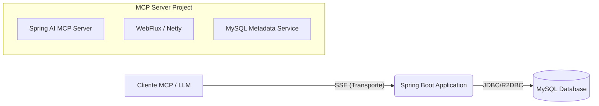
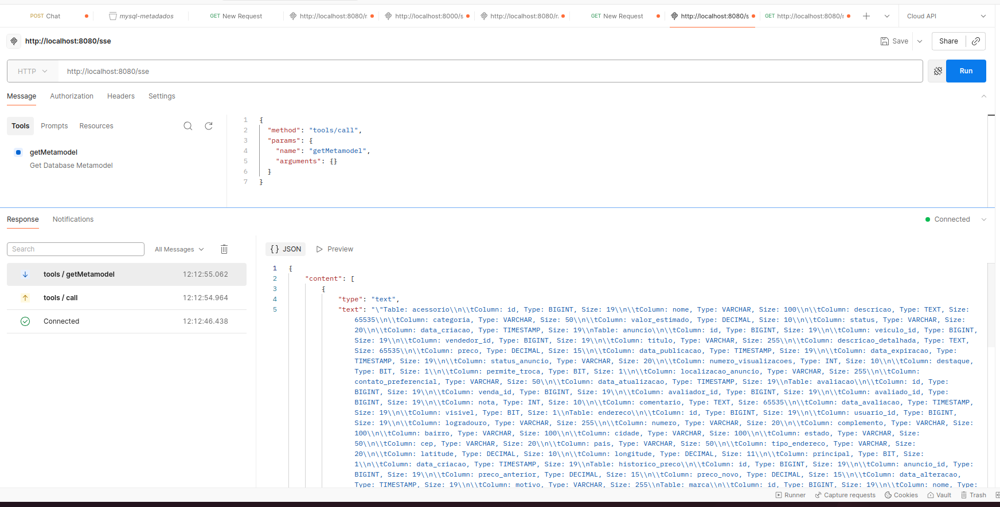

# MCP Server - Metadados MySQL

Este projeto é uma implementação de um **MCP Server** (Model Context Protocol) utilizando **Spring AI** e **Spring WebFlux**. O objetivo principal da aplicação é expor metadados de um banco de dados MySQL (tabelas, colunas, tipos de dados) para agentes de IA e LLMs (Large Language Models) através de **Server-Sent Events (SSE)**.

## 🏗️ Arquitetura do Projeto

A aplicação segue uma arquitetura reativa baseada em eventos, projetada para conectar modelos de IA a dados estruturados em tempo real.



1.  **Cliente MCP:** Um host (como uma IDE ou um Chatbot) conecta-se ao servidor.
2.  **Transporte SSE:** A comunicação é estabelecida via HTTP usando Server-Sent Events para streaming de dados JSON-RPC.
3.  **Serviço de Metadados:** A aplicação consulta o esquema do banco de dados MySQL.
4.  **Exposição:** Os metadados são convertidos em *Resources* ou *Tools* do protocolo MCP e enviados ao cliente.

---

## 📚 Conceitos Chave

### 1. Model Context Protocol (MCP)
O **MCP** é um padrão aberto que permite aos desenvolvedores construir conexões seguras e bidirecionais entre suas fontes de dados e ferramentas e modelos de IA. Em vez de criar integrações específicas para cada LLM, você cria um servidor MCP que qualquer cliente compatível pode consumir.

### 2. MCP Server
O **MCP Server** é a parte da arquitetura que "sabe" como buscar os dados ou executar ações. Neste projeto, o servidor atua como uma ponte para o MySQL, traduzindo a estrutura do banco de dados para um formato que a IA compreende.

### 3. Spring AI
O **Spring AI** é um framework que aplica os princípios de design do ecossistema Spring ao desenvolvimento de IA. Ele fornece abstrações portáteis para interagir com modelos de IA e, crucialmente para este projeto, suporte nativo para implementação do protocolo MCP.

### 4. Módulo `spring-ai-starter-mcp-server-webflux`
Este é o starter específico utilizado no projeto. Ele configura automaticamente um servidor MCP utilizando a stack reativa do Spring (WebFlux).
*   **Por que WebFlux?** O WebFlux é ideal para lidar com conexões de longa duração e streaming de dados, que são características fundamentais do transporte SSE usado pelo MCP. Ele utiliza I/O não bloqueante para alta performance.

### 5. Server-Sent Events (SSE)
**SSE** é uma tecnologia que permite que um servidor envie atualizações automáticas para um cliente via conexão HTTP.
*   No contexto do MCP, o SSE é usado como camada de transporte. O cliente abre uma conexão HTTP e o servidor envia mensagens JSON-RPC (requests, responses, notifications) através desse fluxo contínuo.

---

## 🚀 O Serviço: Metadados MySQL via SSE

O serviço disponibilizado por esta aplicação foca na **introspecção de banco de dados**.

### Funcionalidades:
*   **Conexão:** Estabelece conexão com uma instância MySQL.
*   **Leitura de Esquema:** Lê tabelas, colunas, chaves primárias e tipos de dados.
*   **Exposição MCP:** Disponibiliza essas informações como **Recursos (Resources)** do MCP.

Isso permite que uma IA conectada a este servidor responda perguntas como:
*   *"Quais tabelas existem no banco de dados?"*
*   *"Qual a estrutura da tabela `usuarios`?"*
*   *"Gere uma query SQL baseada no esquema atual."*

---

## 🛠️ Como Executar

### Pré-requisitos
*   Java 21 (fixado no `pom.xml` → `<java.version>21</java.version>`; o parent é Spring Boot 4.0.0)
*   Maven — o wrapper `./mvnw` (Maven 3.9.6) já vem no repositório
*   MySQL 8 em execução — ou o container de `docker-compose/docker-compose.yml`

### Configuração
Configure as credenciais do banco no arquivo `src/main/resources/application.properties` (ou via variáveis de ambiente):

```properties
spring.datasource.url=jdbc:mysql://localhost:3306/seu_banco
spring.datasource.username=seu_usuario
spring.datasource.password=sua_senha
```

### Rodando a Aplicação
Utilize o wrapper do Maven incluído no projeto:

```bash
./mvnw clean spring-boot:run
```

O servidor iniciará (geralmente na porta 8080) e estará pronto para aceitar conexões de clientes MCP no endpoint configurado (padrão `/mcp/message`).

---

## 🧪 Testando com Postman

O Postman oferece suporte para conectar e testar servidores MCP. Isso permite visualizar as capacidades do servidor (ferramentas, recursos e prompts) e interagir com elas diretamente através de uma interface gráfica.

### Passos para testar:

1.  Certifique-se de que a aplicação está rodando.
2.  Abra o Postman.
3.  Utilize a funcionalidade de conexão MCP (MCP Client).
4.  Configure o transporte como **SSE**.
5.  Insira a URL do servidor: `http://localhost:8080/sse` (ou a porta que estiver utilizando).
6.  Conecte-se.

Após conectar, você poderá ver a lista de ferramentas e recursos disponíveis e invocá-los para testar o funcionamento.



---

## Licença

MIT — veja [LICENSE](LICENSE).
